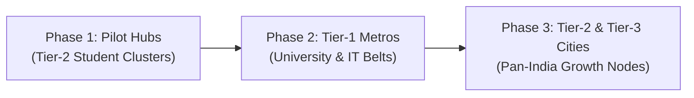

# 🏠 RoomNest — Hyperlocal Student & Professional Rental Housing Platform

> An intelligent, map-centric hyperlocal accommodation discovery and rental platform designed for students and working professionals near educational and tech hubs.

[](https://roomnest.vercel.app/)
[](https://github.com/Mikesh0712/Roomnest)

---

> 💡 **Demo Showcase Note:**  
> Currently, this live deployment serves as a **functional proof-of-concept and prototype demonstration** designed to showcase the core user experience, hyperlocal radius mapping, verification systems, and rental workflow for early testing and investor presentations.

---

## 🔗 Live Showcase Links

- **🌐 Live Web Application:** [https://roomnest.vercel.app](https://roomnest.vercel.app)
- **⚡ Backend API Health:** [https://roomnest-m8uu.onrender.com/api/health](https://roomnest-m8uu.onrender.com/api/health)

---

## 🌟 Key Highlights & Features

- 🗺️ **Interactive Geographic Map**: Real-time Leaflet radius radar showing walking distance to universities and major colleges.
- ⚡ **Hyperlocal Distance & Cost Breakdown**: Exact breakdown of rent, deposit, maintenance, electricity tariffs, food options, and lock-in periods.
- 🛡️ **Verified Properties & Safety Rating**: Verification badges, student/tenant reviews, owner verification, and curfew/policy filters.
- 🔄 **Side-by-Side Property Comparison**: Instant comparative analysis of amenities, deposits, distances, and monthly costs.
- 🔒 **Secure Backend Architecture**: JWT Authentication, Rate Limiting, Mongo Sanitization, and Helmet Security.
- 🌐 **Multilingual Support**: English, Hindi, and Odia local language support.

---

## 🗺️ Future Roadmap & City Expansion

RoomNest is architected to scale rapidly from specialized student micro-markets into a nationwide rental infrastructure across all urban tiers:



### 📍 Planned Rollout Strategy:

1. **Phase 1 — Pilot Student & Coaching Clusters (Current Focus):**
   - Educational zones & university corridors (e.g., Bhubaneswar, Kota, Pune student suburbs).
   - Validation of hyperlocal radar search, verified owner listings, and direct tenant booking.

2. **Phase 2 — Tier-1 Metros & Tech Corridors:**
   - **Cities:** Bengaluru, Delhi NCR, Hyderabad, Mumbai, Pune, Chennai, Kolkata.
   - **Target Segments:** University campus clusters, coaching hubs (Mukherjee Nagar, Kalu Sarai), and tech park commuter belts (Whitefield, Hitec City, Hinjewadi).

3. **Phase 3 — Tier-2 & Tier-3 Growth Cities:**
   - **Cities:** Indore, Jaipur, Chandigarh, Lucknow, Dehradun, Coimbatore, Patna, Cuttack, Vadodara, Visakhapatnam, and emerging educational centers.
   - **Focus:** Standardizing unorganized PG/hostel ecosystems, vernacular localization, and transparent pricing in fast-growing college towns.

---

## 🏗️ Architecture & Tech Stack

```
roomnest/
├── client/                 # React 19 + Vite Frontend SPA (Hosted on Vercel)
│   ├── src/
│   │   ├── components/     # UI, Maps, Modals, Listings, Dashboard
│   │   ├── context/        # App State & Internationalization
│   │   └── utils/          # Formatting & Helpers
│   └── vercel.json         # Vercel Deployment Configuration
│
└── server/                 # Node.js + Express REST API (Hosted on Render)
    ├── data/               # Seed scripts with verified real-world listings
    ├── src/
    │   ├── config/         # MongoDB connection & Cloudinary setup
    │   ├── controllers/    # API endpoint controllers
    │   ├── middleware/     # Auth, Roles, Error & Rate Limiters
    │   ├── models/         # Mongoose Schemas (Property, User, Visit, Review)
    │   ├── routes/         # Modular REST Routes
    │   └── services/       # Business logic layers
    └── server.js           # Server entrypoint
```

---

## 🚀 Quick Start Guide (Local Development)

### 1. Prerequisites
- Node.js (v18 or higher)
- MongoDB instance (Local or MongoDB Atlas)

### 2. Backend Setup
```bash
cd server
npm install
cp .env.example .env     # Configure your MONGO_URI and JWT_SECRET
npm run seed             # Seed sample verified listings
npm run dev              # Starts API on http://localhost:5000
```

### 3. Frontend Setup
```bash
cd ../client
npm install
npm run dev              # Starts frontend on http://localhost:5173
```

---

## ☁️ Deployment Configuration

### Backend on Render
- **Root Directory**: `server`
- **Build Command**: `npm install`
- **Start Command**: `npm start`
- **Environment Variables**:
  - `NODE_ENV=production`
  - `MONGO_URI=<your-atlas-connection-string>`
  - `JWT_SECRET=<your-secret>`
  - `CLIENT_URL=https://roomnest.vercel.app`

### Frontend on Vercel
- **Root Directory**: `client`
- **Framework Preset**: `Vite`
- **Output Directory**: `dist`
- **Environment Variable**:
  - `VITE_API_URL=https://roomnest-m8uu.onrender.com/api`

---

## 📄 License
This project is licensed under the MIT License.
